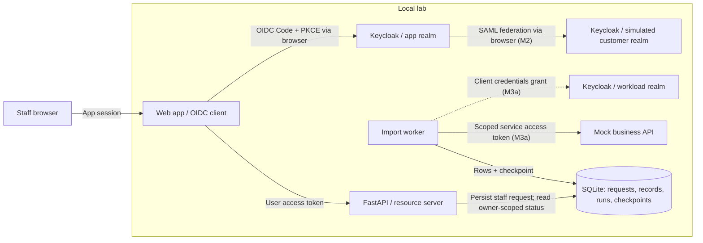
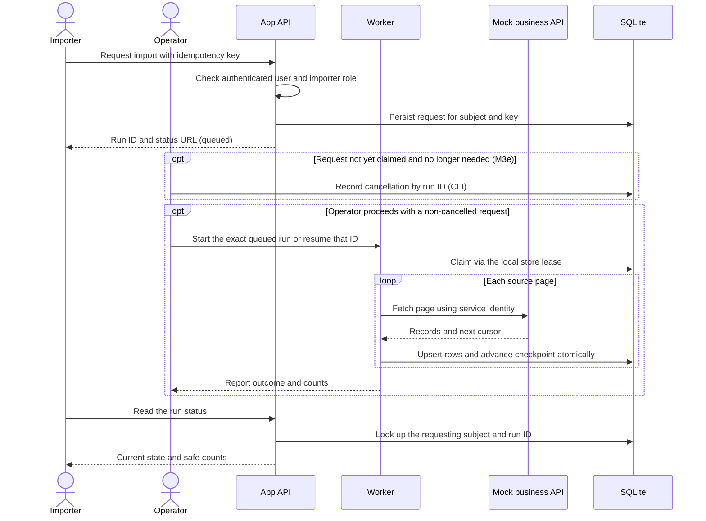

# Architecture

[English README](../README.md) · [日本語 README](../README.ja.md)

## Scenario and boundaries

A customer uses its existing identity provider to sign staff into a case-import application. Staff can view a shared set of synthetic case records; only designated importers can request a sync. The importer can request a job but never receives the job's credentials. A separate operator starts it locally. This lab covers one simulated customer, not tenant isolation or production readiness.

## Components and trust boundaries

The first milestone uses the app realm directly. The SAML broker trusts a configured customer issuer and signing certificate. It maps only explicitly allowed customer groups to app roles; unmapped users gain no data privileges. The [M2 runbook](m2-local.md) records the IdP/SP entity IDs, assertion consumer URL, pinned signing certificates, and role mappings. Use built-in Keycloak support and maintained OIDC libraries rather than implementing protocol parsers.

Keep tokens server-side in the web app, with an HTTP-only session cookie and CSRF protection for state-changing browser requests. The app validates the OIDC login response; the API accepts only access tokens for its own audience and validates signature, issuer, expiry, and audience before checking roles. The [M3a mock source](m3-service-identity.md) trusts a separate local workload realm, audience and read scope; it does not accept the staff token used for the app API. The worker cannot use its token in the staff app. Both realms run in the same disposable Keycloak process, not on separate production infrastructure. Use synthetic data; do not commit live credentials, tokens, or customer metadata.

## Import and recovery

M3a reads source pages without writing. M3b saves and resumes imports from the operator CLI. M3c records a staff request before the operator starts that exact run.

Use a stable source record ID with a uniqueness constraint. The mock API provides a stable cursor over a fixed snapshot for the run. Persist only the last committed cursor; if fetching or validating a page fails, do not advance it. The [M3b operator workflow](m3-recovery.md) serializes imports per store. A run log records the run ID, snapshot, status, counts, cursor and error category, but not token values or payloads. Only the request table stores the staff subject and idempotency key. Neither the staff API nor the status response reads any workload credential. The local operator can inspect the staff queue from a read-only SQLite snapshot (M3d), or [cancel an unclaimed request](m3-staff-requests.md#cancel-a-queued-request-m3e) (M3e). Claim and cancellation serialize in SQLite; the owner sees the same ID through either outcome, and a duplicate request key never creates new work. Only an explicit operator command starts or resumes a worker; there is no automatic dispatcher. Production concerns such as cursor expiry, source changes during a run, key rotation and operational SLAs are follow-up design topics.

## References

- [OpenID Connect Core](https://openid.net/specs/openid-connect-core-1_0.html)
- [OAuth 2.0 Security Best Current Practice](https://www.rfc-editor.org/rfc/rfc9700)
- [Keycloak identity brokering](https://www.keycloak.org/docs/latest/server_admin/#_identity_broker)
