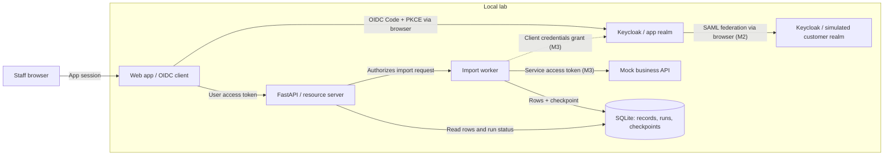
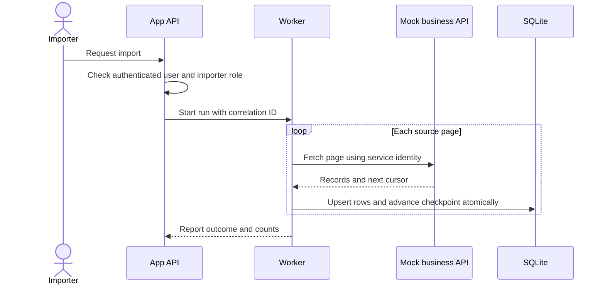

# Architecture

[English README](../README.md) · [日本語 README](../README.ja.md)

## Scenario and boundaries

A customer uses its existing identity provider to sign staff into a case-import application. Staff can view a shared set of synthetic case records; only designated importers can request a sync. The importer can trigger a job but never receives the job's credentials. This lab covers one simulated customer, not tenant isolation or production readiness.

## Components and trust boundaries

The first milestone uses the app realm directly. The SAML broker trusts a configured customer issuer and signing certificate. It maps only explicitly allowed customer groups to app roles; unmapped users gain no data privileges. Record the IdP/SP entity IDs, assertion consumer URL, certificate ownership, and role mapping in the eventual configuration guide. Use built-in Keycloak support and maintained OIDC libraries rather than implementing protocol parsers.

Keep tokens server-side in the web app, with an HTTP-only session cookie and CSRF protection for state-changing browser requests. The app validates the OIDC login response; the API accepts only access tokens for its own audience and validates signature, issuer, expiry, and audience before checking roles. The mock source has a distinct audience and read scope; it does not accept the user token used for the app API. Scope the worker identity to reading case records. Use synthetic data; do not commit live credentials, tokens, or customer metadata.

## Import and recovery

Use a stable source record ID with a uniqueness constraint. The mock API provides a stable cursor over a fixed snapshot for the run. Persist only the last committed cursor; if fetching or validating a page fails, do not advance it. In the first implementation, serialize imports rather than allowing concurrent jobs. A run log records request ID, initiating test account, status, counts and error category, but not token values or record payloads. Production concerns such as cursor expiry, source changes during a run, key rotation and operational SLAs are follow-up design topics.

## References

- [OpenID Connect Core](https://openid.net/specs/openid-connect-core-1_0.html)
- [OAuth 2.0 Security Best Current Practice](https://www.rfc-editor.org/rfc/rfc9700)
- [Keycloak identity brokering](https://www.keycloak.org/docs/latest/server_admin/#_identity_broker)
